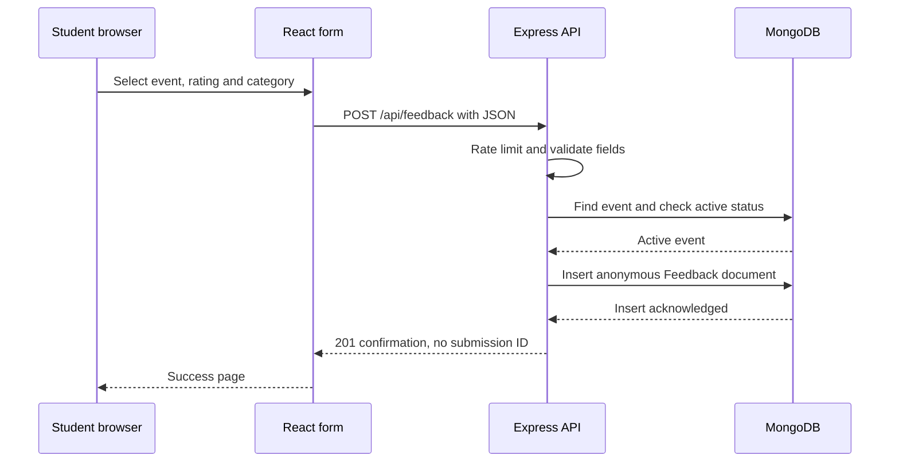
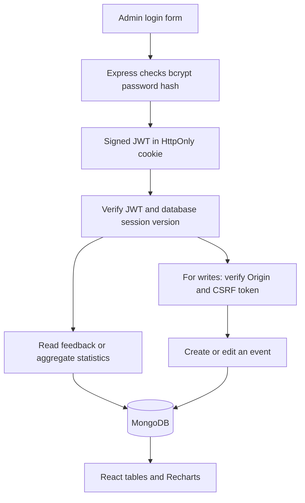

# Understanding and presenting ClubPulse

Use this guide with the code open. Run the application, trace one request, and change one small feature before presenting. The goal is to explain what the application actually does, including its limitations.

## A. Introduce your project

### Thirty-second introduction

“ClubPulse helps college clubs collect honest feedback after events. Students choose an event and submit a rating and optional comment without creating an account. Administrators sign in to filter responses and view real statistics. I used React for the interface, Express and Node for the API, and MongoDB for storage. My main focus was making the feedback flow work end to end while keeping student identities out of the feedback records.”

### One-minute introduction

“After a workshop, organizers often get scattered comments, and students may hesitate to criticize an event when their names are attached. ClubPulse addresses both problems. Its public portal collects structured, anonymous feedback without student accounts. The admin workspace has authenticated access, combined filters, pagination, charts, and event management.

“The backend validates inputs, checks that an event is accepting feedback, and stores the response in MongoDB. Dashboard figures come from MongoDB aggregation queries, rather than frontend sample numbers. Admin passwords are hashed with bcrypt, and the session uses an HTTP-only JWT cookie with CSRF checks and server-side logout revocation.

“I used AI assistance for implementation and review, and I’m learning the code by tracing its requests and tests. The local application has been tested against real MongoDB and through a Chromium browser. Deployment is prepared but pending approval; I would only call it deployed after checking the actual hosting environment.”

Update that last sentence only after a real deployment has been verified.

### Why choose this project?

It solves a familiar college problem, demonstrates every MERN layer, and has a scope you can explain. The interesting technical work is the full request lifecycle: validation, authentication, database queries, and presenting accurate results. It does not depend on an external AI API or a paid service.

## B. Architecture and data flow





- **React** displays the current state and sends HTTP requests. It has no database password.
- **Express** decides whether each request is valid and authorized. The server remains authoritative even if someone bypasses the UI.
- **Mongoose** describes the document structure and provides database operations.
- **MongoDB** persists the records and computes aggregated statistics.
- **The session cookie** is automatically attached by the browser to matching requests. React cannot read the HTTP-only token.
- **The CSRF token** is returned by the API, held in React memory, and attached to authenticated writes.
- **The proxy** lets the browser call `/api` on the frontend origin. Vite provides it locally; the planned Vercel rewrite provides it in production.

## C. Ten important files to understand

Line numbers below identify the current implementation; use the named function if later edits move a line. Open each file and read the surrounding function rather than memorizing only one line.

### 1. `server/src/app.js` — assembling the API

**Why it exists:** It constructs Express without immediately opening a port. Tests can pass this app directly to Supertest.

**Important work:** `createApp` at line 13 installs Helmet, CORS, Origin/content-type checks, a 16 KB JSON limit, cookies, rate limits, health checks, routes, and the final error handler.

**Connections:** `index.js` connects MongoDB, calls `createApp`, and listens. Route files connect this application to controllers.

**Show the judges:** Line 13 onward, especially the trusted-Origin middleware and `app.use('/api/admin', ...)`.

**Likely question:** “Why does middleware order matter?” The cookie parser must run before authentication reads cookies. The error handler must come after routes so it can receive their errors.

### 2. `server/src/models/Feedback.js` — the stored anonymous record

**Why it exists:** It defines what a feedback document can contain.

**Important work:** `CATEGORIES` at line 2 lists allowed categories. `feedbackSchema` defines an event reference, integer rating, category, optional text/recommendation, and creation time. The final indexes support common retrieval patterns.

**Connections:** The submission controller creates this model; the list controller queries it; the analytics controller aggregates it.

**Show the judges:** Line 2 and the schema immediately below it. Point out the absence of identity fields and the `Number.isInteger` validation. Then show the indexes near the end.

**Likely question:** “Is this absolutely anonymous?” No. The application does not associate a response with a student identity, but free text or external hosting logs could still reveal information.

### 3. `server/src/controllers/feedbackController.js` — submission and filtering

**Why it exists:** It contains the public submission behavior and private feedback-list behavior.

**Important work:** `submitFeedback` at line 12 validates the allowlisted fields, finds the event, checks its status, and awaits `Feedback.create`. `listFeedback` at line 33 builds a combined filter and runs a paginated query plus a matching count.

**Connections:** Public and admin routers use different functions from this file. Both functions use the same Feedback model.

**Show the judges:** The lines containing `await Event.findById`, the 409 closed-event check, and `await Feedback.create(data)` inside `submitFeedback`. Then start at line 33 and follow filter construction into `find(filter)` and `countDocuments(filter)`.

**Likely question:** “Why also validate on the backend?” A browser's validation can be bypassed with a custom HTTP request. Only server-side validation protects the database.

### 4. `server/src/controllers/authController.js` — login and logout

**Why it exists:** It verifies administrator credentials and creates or revokes sessions.

**Important work:** `authController` at line 12 exposes login, logout, and me. Login uses `bcrypt.compare`, increments `sessionVersion`, signs an eight-hour JWT, and sends an HTTP-only cookie. Logout increments the database version and clears the cookie.

**Connections:** `authRoutes.js` provides the HTTP endpoints. `authMiddleware.js` checks the token on later requests. `Admin.js` stores the hash and version.

**Show the judges:** `bcrypt.compare` inside login, the version increment around line 31, and logout's conditional update around line 50.

**Likely question:** “Why isn't deleting the cookie enough?” A previously copied JWT would otherwise remain valid. The database version check makes the old token invalid on the server too.

### 5. `server/src/middleware/authMiddleware.js` — protected access and CSRF

**Why it exists:** It avoids repeating authentication code in every admin controller.

**Important work:** `csrfToken` at line 6 derives an HMAC token tied to the session. `requireAuth` at line 14 verifies JWT signature, algorithm, issuer, audience, expiry, and database session version. `requireCsrf` at line 37 verifies a constant-format token with a timing-safe comparison on writes.

**Connections:** `adminRoutes.js` applies both middleware functions before management routes. Auth routes use them for `/me` and `/logout` as needed.

**Show the judges:** Line 14 onward and the comparison between `admin.sessionVersion` and the token's version around line 30. Then show `requireCsrf`.

**Likely question:** “Why does a cookie need CSRF protection?” Browsers attach cookies automatically. A malicious site could try to cause a signed-in browser to send requests; trusted Origin checks and a token the malicious site cannot read protect mutations.

### 6. `server/src/controllers/analyticsController.js` — accurate statistics

**Why it exists:** Statistics must cover all stored responses, not just the ten visible on one page.

**Important work:** `statistics` at line 3 uses `Feedback.aggregate` at line 9 with `$facet` pipelines for summary, distribution, daily trend, and per-event results. It fills missing rating buckets and days with zero and returns `null` for an undefined average.

**Connections:** `/api/admin/stats` uses this controller. `Dashboard.jsx` passes its output to Recharts.

**Show the judges:** `$group`, `$avg: '$rating'`, and the `$cond` that counts ratings greater than or equal to 4. Then show the zero-safe response construction.

**Likely question:** “How do you know the average is correct?” The integration test inserts ratings 5, 4, 1, and 2 and asserts average 3 and positive percentage 50. The calculation runs in MongoDB.

### 7. `client/src/pages/FeedbackPage.jsx` — public form behavior

**Why it exists:** It gives participants a straightforward way to send feedback without logging in.

**Important work:** State declarations near the start of `FeedbackPage` hold the user’s choices. `submit` validates the optional comment, prevents duplicate clicks using a ref, calls the API, and navigates to the success page only after success.

**Connections:** `useApi('/events')` loads selectable events. `api.js` sends the submission. React Router displays the success route.

**Show the judges:** The `submit` handler, especially `await api('/feedback', ...)` and the `try/catch/finally` behavior. Then show the native radio groups for ratings and categories in the JSX. The redesigned presentation still sends the same API payload; [the interface guide](docs/DESIGN.md) explains the shared controls.

**Likely question:** “What happens if the network fails?” The form keeps the user's input, clears its loading state, and displays an error. It does not show success before the server acknowledges persistence.

### 8. `client/src/services/api.js` — shared HTTP behavior

**Why it exists:** Every page should use the same credentials, header, and error conventions.

**Important work:** `api` at line 6 calls Fetch with `credentials: 'include'`, serializes JSON, attaches the custom request/CSRF headers, parses JSON, and throws meaningful errors on non-success statuses. It handles the 204 logout response separately.

**Connections:** Forms, hooks, and AuthContext call this helper. It never talks directly to MongoDB.

**Show the judges:** Line 6 onward and the `if (!response.ok)` branch. Mention that Fetch does not throw automatically for an HTTP 400 or 500.

**Likely question:** “Where is your JWT stored?” In a server-set HTTP-only cookie. This module holds only the CSRF token in memory, not the JWT.

### 9. `client/src/context/AuthContext.jsx` — browser authentication state

**Why it exists:** The login page, protected routes, and sidebar need shared knowledge of the current administrator.

**Important work:** `AuthProvider` at line 4 stores profile/loading/error state. The effect at line 9 calls `/auth/me` after page load. `login` at line 38 and `logout` at line 44 update the shared state after their API calls.

**Connections:** `App.jsx` uses the context to decide which UI to show; `AdminLayout.jsx` uses it for the profile and logout action.

**Show the judges:** The `/auth/me` effect and `login`/`logout`. Explain that the frontend guard is user experience, while Express middleware is the actual access control.

**Likely question:** “What happens after refresh?” JavaScript memory is recreated, but the browser still has its cookie. `/auth/me` validates that session and restores the profile and CSRF token.

### 10. `server/src/scripts/createAdmin.js` — initial account setup

**Why it exists:** A public registration route would let arbitrary visitors become administrators. A controlled script creates the first admin instead.

**Important work:** The main block near the top validates `ADMIN_EMAIL` and `ADMIN_PASSWORD`, connects MongoDB, checks for an existing email, hashes the password with bcrypt cost 12, and inserts the admin only if absent. `finally` disconnects the database.

**Connections:** `npm run admin:create` invokes it. It uses the Admin model and shared database connector, but it is not an HTTP route.

**Show the judges:** The environment-variable reads and the branch containing `bcrypt.hash(password, 12)`. Do not display your real `.env` during the presentation.

**Likely question:** “What if you run it twice?” The existing account remains unchanged. It does not silently reset a password.

## D. Technical fundamentals, using this project

| Concept               | Plain explanation                                                                      | ClubPulse example                                                                                          |
| --------------------- | -------------------------------------------------------------------------------------- | ---------------------------------------------------------------------------------------------------------- |
| React                 | A library for describing interfaces using reusable pieces and state.                   | A rating click updates the form without manually replacing DOM elements.                                   |
| Component             | A function that returns UI for a particular responsibility.                            | `Rating` renders the same rating badge in different screens.                                               |
| `useState`            | Holds a value that survives re-renders; its setter triggers another render.            | `const [rating, setRating] = useState(0)` stores the selected rating.                                      |
| `useEffect`           | Runs synchronization work after rendering and can clean it up.                         | `useApi` fetches when its path changes and aborts the old request on cleanup.                              |
| API                   | A defined way for programs to communicate.                                             | The frontend sends JSON to `/api/feedback`.                                                                |
| Node.js               | Runs JavaScript outside a browser.                                                     | It runs the Express server and admin-creation script.                                                      |
| Express               | A Node library for HTTP routes and middleware.                                         | It maps POST `/api/feedback` to the submission controller.                                                 |
| MongoDB               | A database that stores BSON documents in collections.                                  | Feedback documents retain ratings and comments after the page closes.                                      |
| Mongoose              | A MongoDB library that adds schemas, validation, models, and query helpers.            | `Feedback.create(data)` validates and saves a document.                                                    |
| CRUD                  | Create, read, update, delete: common data operations.                                  | ClubPulse creates feedback, reads it, and creates/updates events. It intentionally has no delete endpoint. |
| REST                  | An HTTP resource-oriented API design style.                                            | GET reads events, POST creates an event, PATCH updates an event.                                           |
| Authentication        | Establishing who a requester is.                                                       | Login verifies the admin password.                                                                         |
| Authorization         | Deciding what the authenticated requester may do.                                      | Admin middleware protects private feedback and event edits.                                                |
| JWT                   | A signed token containing claims. Its signature detects changes; it is not encryption. | The cookie token contains admin ID, session version, random token ID, and expiry.                          |
| Password hashing      | One-way transformation for verification without storing the original password.         | bcrypt hashes a chosen password; `compare` checks a later login.                                           |
| Middleware            | Functions that run in the request pipeline before or after a route.                    | Helmet, rate limiting, authentication, and errors.                                                         |
| Filtering             | Building database conditions from validated query parameters.                          | Event and rating conditions in the same object combine with AND.                                           |
| Aggregation           | A database pipeline that groups, counts, and computes values.                          | `$group` calculates average rating across matching documents.                                              |
| Application anonymity | Records do not link a submission to a student identity.                                | The Feedback schema contains no student email or name.                                                     |

### Three code snippets to explain aloud

From `feedbackController.js`:

```js
const event = await Event.findById(data.eventId).select('status');
if (!event) throw new HttpError(404, 'Event not found.');
if (event.status !== 'active')
  throw new HttpError(409, 'This event is no longer accepting feedback.');
await Feedback.create(data);
```

Explain: “I load only the status needed for this decision. Missing and closed events get different errors. I await the database insert before returning success.”

From `authMiddleware.js`:

```js
const admin = await Admin.findById(payload.sub).select('+sessionVersion');
if (!admin || admin.sessionVersion !== payload.version) throw new Error('Revoked session');
```

Explain: “The token signature alone is not enough for immediate logout. The database version must still match. Logging out changes that version.”

From the analytics summary pipeline:

```js
averageRating: {
  $avg: '$rating';
}
```

Explain: “MongoDB computes the average using the stored rating field. I do not average only the records in the currently visible feedback page.”

## E. Thirty realistic interview questions

1. **What problem does ClubPulse solve?** It makes structured, anonymous event feedback easy to submit and gives organizers protected tools to interpret it.
2. **Why MERN?** React handles interactive UI, Express provides HTTP endpoints, Node runs the backend in JavaScript, and MongoDB stores flexible feedback documents. It also matches the recruitment requirement.
3. **Why doesn't a student log in?** The public submission workflow does not need an identity. Requiring an account would add friction and create an identity association to manage.
4. **How do you prove the backend is real?** Submit feedback in a fresh browser, find it through the authenticated API, and inspect a count/average update. Integration tests query the actual MongoDB document.
5. **What data is in a feedback record?** An event reference, rating, category, optional comment and recommendation, creation time, and MongoDB metadata. No student identity or raw address.
6. **Can you promise absolute anonymity?** No. The application does not collect student identities, but text and external infrastructure logs can reveal information. The UI explains this limit.
7. **Why is the event an ObjectId reference?** Responses point to an existing event without copying its details into every document. Mongoose `populate` supplies the title when listing responses.
8. **What stops feedback for a closed event?** The server loads its current status and returns 409 before inserting. The public event list also omits closed events.
9. **Does the event date automatically expire feedback?** No. Status is explicit. That lets organizers collect feedback after the event takes place. There is no hidden automatic date rule.
10. **Why validate twice, in React and Express?** React helps the user correct mistakes quickly. Express protects the database even when the UI is bypassed.
11. **How are passwords stored?** As bcrypt hashes with cost 12. The initialization script never saves plaintext in MongoDB, and the running API uses bcrypt comparison.
12. **Why is there a 72-byte password limit?** bcrypt only uses up to 72 input bytes. Checking the UTF-8 byte length prevents silently treating longer passwords as their truncated prefix.
13. **What does JWT verification check?** Signature, allowed algorithm, issuer, audience, and expiry. Then middleware checks the administrator still exists and its session version matches.
14. **Where is the session stored?** The browser stores an HTTP-only cookie containing the signed JWT. MongoDB stores a session version for revocation. React stores only the profile and CSRF token in memory.
15. **What does HttpOnly do?** It stops JavaScript from reading the cookie. The browser can still send it with appropriate HTTP requests. It does not by itself prevent all XSS or CSRF attacks.
16. **What does logging out do?** It increments the database session version and clears the browser cookie. A copied old cookie no longer passes server authentication.
17. **Can the same admin sign in on two devices?** The current design allows one active session. A new login increments the version and invalidates previous logins. This is documented as a deliberate simplification.
18. **What is CSRF and how do you handle it?** A hostile site tries to make the user's browser send authenticated actions. ClubPulse checks trusted Origin, a custom JSON request header, and a session-bound CSRF token for admin writes.
19. **What is CORS?** Browser rules that control which origins can read responses. ClubPulse allows configured exact origins with credentials. CORS is not a substitute for server authentication or Origin/CSRF validation.
20. **Why use a same-origin API proxy?** It lets the browser keep a first-party session cookie on the frontend origin. This avoids depending on cross-site cookies, which some browsers block.
21. **How do several filters work together?** Validated fields are added to one MongoDB filter object. An event ID and rating must both match. Date bounds and escaped comment search can be combined too.
22. **How do you avoid NoSQL injection?** Inputs must be expected primitive types, unknown fields are rejected, IDs are checked, and the server builds the query. It does not pass an arbitrary request object to MongoDB.
23. **How does pagination work?** `skip((page - 1) * limit)` chooses the offset, `limit(limit)` bounds records, and `countDocuments` gives the total for that same filter. Ordering includes ID as a tie-breaker.
24. **Why use aggregation for analytics?** It computes totals, averages, distributions, and groups inside MongoDB over the actual dataset. It avoids downloading every response to the browser.
25. **What is positive feedback and what happens with zero records?** Positive is rating 4 or 5. With no feedback the percentage is zero, the average is null, and the UI shows an empty state rather than a fabricated rating.
26. **What do your indexes do?** They support finding feedback by event or rating and retrieving it by creation date. They cost storage and write work, so I added indexes for real query patterns rather than every field.
27. **How do you reduce spam without student identities?** Temporary network-based rate limits and request-size limits reduce repeated requests. They do not guarantee one response per person and can affect shared networks.
28. **How do tests avoid changing demo data?** API and browser tests create separate temporary real MongoDB processes. They do not connect using the application's `MONGODB_URI` or reuse its persistent database.
29. **What is still unverified?** The planned Atlas/Render/Vercel deployment and actual cookie behavior on those future domains. Chromium local tests and production builds cannot establish live hosting success.
30. **What would you improve next, and how did you use AI?** After an approved deployment, I would verify other browsers and consider export, better search, or multi-session admins if needed. AI assisted implementation and testing; I reviewed and practiced the flows I can explain, and I do not claim to have manually written every line.

## F. Five-minute code walkthrough

| Time      | File to open                                                   | What to show                                                                |
| --------- | -------------------------------------------------------------- | --------------------------------------------------------------------------- |
| 0:00–0:35 | `client/src/pages/FeedbackPage.jsx`                            | State and the submit handler. A UI action begins an HTTP request.           |
| 0:35–1:00 | `client/src/services/api.js`                                   | Fetch, JSON, credentials, and explicit HTTP errors.                         |
| 1:00–1:25 | `server/src/app.js` then `server/src/routes/feedbackRoutes.js` | Middleware pipeline and the route mapping.                                  |
| 1:25–2:05 | `server/src/controllers/feedbackController.js`                 | Validation, event status, and awaited insertion.                            |
| 2:05–2:30 | `server/src/models/Feedback.js`                                | Schema, reference, indexes, and absence of identity fields.                 |
| 2:30–3:10 | `server/src/controllers/authController.js`                     | Password comparison, signed cookie, revocable session.                      |
| 3:10–3:40 | `server/src/middleware/authMiddleware.js`                      | Why a frontend route guard is not sufficient.                               |
| 3:40–4:20 | `server/src/controllers/analyticsController.js`                | Database aggregation and zero-safe results.                                 |
| 4:20–5:00 | `server/test/api.test.js` and `tests/e2e/workflow.spec.js`     | Tests of real persistence, exact analytics, and a fresh-browser submission. |

Do not open `.env` while sharing your screen. Show `.env.example` if asked about configuration.

## G. Five-minute live demonstration

Before the demo, start MongoDB and both servers. Use credentials stored securely. Create one clearly named demonstration event; do not present demonstration responses as real student research. If using free approved hosting later, check cold-start readiness beforehand.

1. **0:00–0:45 — Public purpose.** Show the landing page and the absence of student registration. Explain application-level anonymity and open the event.
2. **0:45–1:30 — Submit.** Select a rating/category, type a constructive demonstration comment, optionally recommend, and submit. Point out that the success screen appears after the server accepts it.
3. **1:30–2:15 — Admin access.** Open the admin workspace and sign in without revealing the password. Explain HTTP-only cookies and that the public user could not read private responses.
4. **2:15–3:00 — Find the response.** Filter by event and rating together; add a phrase from the comment. Change a filter to show the no-match state, then clear it.
5. **3:00–3:45 — Analytics.** Refresh the dashboard. Explain total count, mean, and positive percentage using the actual records. A rating of 3 is not positive; 4 and 5 are positive.
6. **3:45–4:20 — Event controls.** Close the event and show that the public selector no longer offers it. Existing feedback remains visible to the administrator.
7. **4:20–5:00 — Architecture and logout.** Open the README diagram, name the four MERN parts, then log out and show protected access returning to login.

If connectivity fails, show the honest error and diagnose it. Do not use a screenshot as evidence of a live operation or claim a deployed URL exists if approval is still pending.

## H. Five possible live-coding changes

### 1. Add a feedback category

Add the same string to `CATEGORIES` in `server/src/models/Feedback.js` and `categories` in `client/src/utils/format.js`. The server list controls validation; the client list controls choices. Add an integration assertion that the new category is accepted. Run `npm test`, `npm run build`, and submit through the form. Do not remove existing stored categories without a migration plan.

### 2. Add recommendation percentage to the dashboard

Add counts in the analytics aggregation for `wouldRecommend === true` and for answered boolean recommendations. Divide yes answers by answered recommendations, not by every response, because the question is optional. Return null when nobody answered. Display another card in `Dashboard.jsx` and test yes/no/unanswered records explicitly.

### 3. Add a “positive only” feedback filter

Add a recognized query parameter in `listFeedback` and validate its allowed values. Use `rating: { $gte: 4 }` for positive responses. Decide how it combines with an exact rating: reject conflicting choices or define the intersection. Update the UI and tests for the chosen rule. Do not filter just the ten visible rows in React.

### 4. Change the comment length rule

Update the controller validation, the Feedback schema, the textarea's `maxLength`/counter, and any client-side minimum check together. Test just below, at, and above the limit, including an omitted comment because comments are optional. Update the README rule. Preserve existing records rather than modifying data unnecessarily.

### 5. Improve the feedback rating component

Change the descriptions or icon styling in the rating options of `FeedbackPage.jsx`. Keep the radio inputs, labels, keyboard focus, and integer values. Verify selection by keyboard and on a narrow screen. A visual change should not change the API's 1–5 contract.

For any request: explain the desired behavior, identify the authoritative server rule, make the smallest coherent change, and run the relevant check. It is acceptable to consult the code; inventing an explanation is worse than taking a moment to inspect it.

## I. Describe AI assistance accurately

A truthful statement is:

> “I used AI to help scaffold and implement the project, generate test cases, and review the flow. I am responsible for understanding what I present. I tested the public submission and admin workflows, studied the main controllers and models, and can explain the design decisions and current limitations.”

Only include “I tested” or “I studied” once you personally did those activities. You can distinguish automated checks performed during development from your own manual verification.

Do not claim you manually wrote every line or independently designed parts you have not reviewed. If a judge asks about unfamiliar code, say: “That part was AI-assisted. My current understanding is …; let me trace the function to confirm.” Then follow imports and data flow.

A practical two-day study schedule:

- First session: run locally, create your own admin and event, submit from a fresh browser, and trace `FeedbackPage → api → route → controller → model`.
- Second session: inspect login, cookie flags, session revocation, and one aggregation pipeline. Run the tests and read an assertion you understand.
- Third session: make one safe change from section H and explain the result aloud.
- Final session: rehearse the five-minute demo, check secret handling, verify any approved deployment, and prepare an honest list of limitations.
