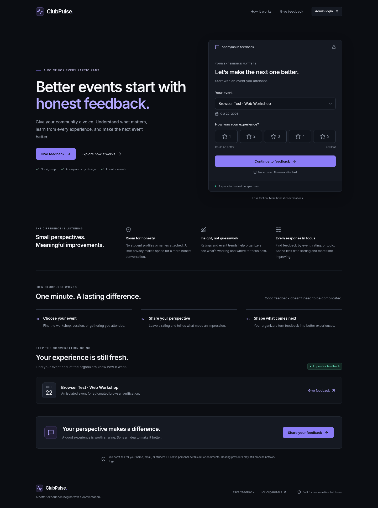
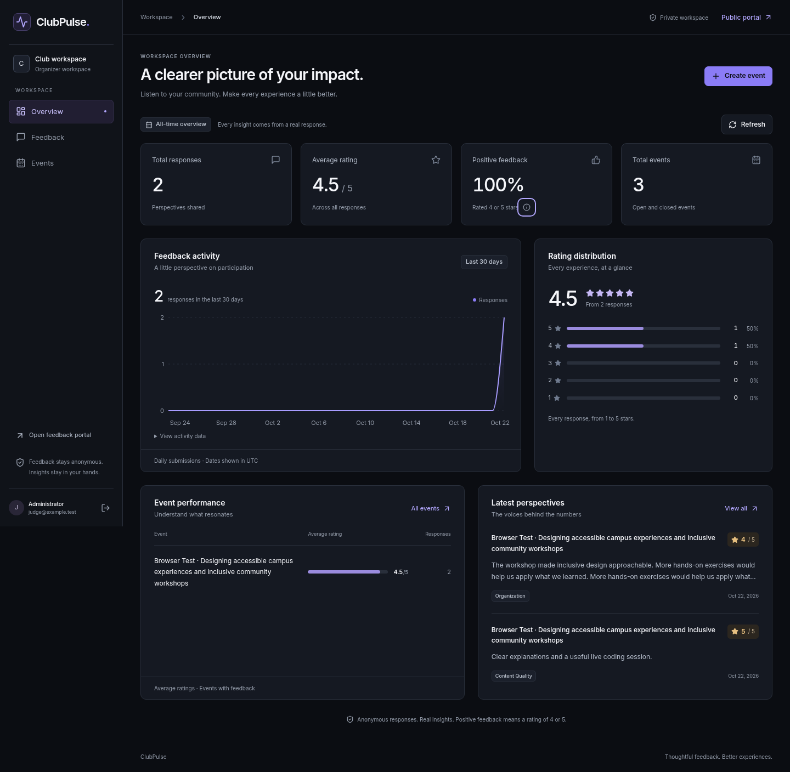
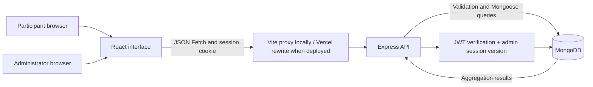

# ClubPulse

**Honest feedback. Better events.**

ClubPulse is a MERN application for college clubs to collect anonymous event feedback and turn it into useful insights. Participants do not create accounts. Authorized organizers sign in to manage events, filter responses, and view statistics calculated from MongoDB records.

Built for a technical recruitment demonstration, with readable controllers, real persistence, and a companion [interview guide](INTERVIEW_PREP.md).

> **Status:** implemented and locally verified. The initial application was pushed to GitHub with the owner’s approval. This revision includes the complete frontend redesign. No live deployment has been verified. The owner has approved publishing this source revision. Deployment still requires approval; do not activate paid services.

## Why this exists

Students may hesitate to criticize a workshop when their name is attached. Organizers need more than an unstructured collection of comments. ClubPulse separates an anonymous public portal from a protected workspace, giving students a simple way to be heard and organizers a clear view of what to improve.

## Features

- Public landing page, open-event selection, anonymous rating/category/comment form, optional recommendation, and confirmation page.
- Real bcrypt password verification and JWT authentication in HTTP-only cookies.
- Server-side session revocation on logout; no public administrator registration.
- Admin overview: total responses, total events, average rating, positive percentage, 30-day activity, rating distribution, event comparison, and recent feedback.
- Combined server-side filters for event, rating, category, inclusive UTC date range, and literal comment search; pagination with totals.
- Event creation, editing, and opening/closing feedback, with associated response counts.
- Responsive dark interface with a consistent design system, mobile feedback cards, keyboard-accessible dialogs, loading/error/empty states, and mobile navigation. See the [interface guide](docs/DESIGN.md).
- Input validation, request-size limits, rate limiting, exact-origin CORS, CSRF protection, and Helmet headers.
- Real-database API tests and end-to-end Chromium tests.

**Positive feedback means a rating of 4 or 5.** All overview totals are all-time; the activity chart shows the last 30 UTC calendar days. No example feedback or analytics is seeded into the development/production application.

## Screenshots

These screenshots show the real application. The screenshots use clearly labeled automated-test events. Dashboard responses were actually submitted through the UI to an isolated MongoDB database.




[Mobile feedback form](docs/screenshots/feedback-mobile.png) · [Mobile admin feedback](docs/screenshots/admin-feedback-mobile.png) · [Empty overview](docs/screenshots/overview-empty.png) · [Admin login](docs/screenshots/login.png)

For changed files, design decisions, and updated preview instructions, see [DESIGN.md](docs/DESIGN.md).

## Stack and architecture

| Layer                | Tools                                                                                                              |
| -------------------- | ------------------------------------------------------------------------------------------------------------------ |
| Frontend             | React 19, Vite 7, Tailwind CSS 4 plus readable component CSS, React Router, Lucide, Recharts, Sonner, native Fetch |
| Backend              | Node.js 24, Express 5, Mongoose, bcryptjs, JWT, cookie-parser, Helmet, CORS, express-rate-limit, dotenv            |
| Database             | MongoDB 7 locally; MongoDB Atlas for the planned deployment                                                        |
| Verification         | Node test runner, Supertest, mongodb-memory-server, Playwright/Chromium                                            |
| Deployment templates | Vercel frontend, Render API, Atlas database; not yet deployed                                                      |



The frontend calls `/api`, so the browser sees one origin. In development Vite forwards those requests to port 5000. The production template forwards them from Vercel to Render. The database URI and JWT secret exist only on the server.

## Project structure

```text
client/
  src/
    components/{ui,layout,dashboard}/
    context/AuthContext.jsx
    hooks/useApi.js
    pages/                       # All seven application pages
    services/api.js
    utils/format.js
    App.jsx, main.jsx, styles.css
server/
  src/
    config/                      # Validated environment and database connection
    models/                      # Event, Feedback, Admin
    controllers/                 # Public submissions, auth, management, analytics
    middleware/                  # Authentication, CSRF, centralized errors
    routes/                      # Public and protected REST routes
    scripts/                     # Admin setup, optional events, local database
    utils/validation.js
    app.js, index.js
  test/                          # Real-Mongo API tests and browser test server
tests/e2e/                       # Browser workflow and responsive checks
docs/                            # Deployment, verification, screenshots
README.md, INTERVIEW_PREP.md
render.yaml, vercel.json          # Templates only
```

## Run locally

Prerequisites: **Node.js 24** (see `.nvmrc`), npm, and MongoDB. You can use an existing local MongoDB installation or the helper below. Run commands from the repository root unless stated otherwise.

```bash
npm ci
cp server/.env.example server/.env
cp client/.env.example client/.env
```

Edit the ignored `server/.env` locally. Set a strong random `JWT_SECRET` of at least 32 characters. Use a password manager or another secure generator; do not paste secrets into chat, source code, or a public terminal recording.

Choose your database:

1. **Existing local MongoDB:** start it listening on `127.0.0.1` and use `mongodb://127.0.0.1:27017/clubpulse`.
2. **Included local helper:** in a separate terminal run `npm run dev:db`. This downloads an official MongoDB 7.0.24 binary on first use, starts a real `mongod` bound to `127.0.0.1:27017`, and keeps WiredTiger data under `~/.clubpulse/mongo`. It does not emulate MongoDB. Its download requires HTTPS access to `fastdl.mongodb.org`. A local verified binary can instead be provided with `MONGOMS_SYSTEM_BINARY`.
3. **Atlas:** use your own securely stored URI and database user, with a database access list restricted to the clients that need it. See [deployment instructions](docs/DEPLOYMENT.md). Cloud provisioning requires approval.

For initial administrator setup, put your chosen `ADMIN_EMAIL` and `ADMIN_PASSWORD` into the ignored server environment. The password must be at least 12 characters and at most 72 UTF-8 bytes (bcrypt's input limit).

```bash
npm run admin:create
npm run seed:events  # Optional: adds two clearly labeled demo events, never feedback
npm run dev
```

`admin:create` hashes the password with bcrypt (cost 12). Running it again for the same email leaves the existing password unchanged. Save your password securely and remove `ADMIN_PASSWORD` from the environment after initialization. The API does not need that variable during normal operation.

Vite uses port **5173**; the API uses **5000**. Use your local browser to open the Vite server. Sign in with the credentials you chose. You can create actual club events and close the sample events in the admin workspace.

```bash
curl --fail http://127.0.0.1:5000/api/health
# Expected: {"status":"ok","database":"connected"}
```

Stop the development servers with Ctrl+C. The local helper's database files persist after a graceful stop. If port 27017 is already occupied, use the existing database or stop the process you own before starting the helper. Never expose the unauthenticated local helper beyond loopback.

### This cloud workspace

The workspace has a verified MongoDB 7.0.24 binary at `/workspace/.cache/mongodb-binaries/mongod-official-7.0.24`. It was extracted from the official `library/mongo:7.0.24` image without running Docker; the layer SHA-256 was verified. See [verification notes](docs/VERIFICATION.md) for provenance.

The ignored `server/.env` points to that binary and stores local development secrets. Local data is under `/workspace/.clubpulse/mongo`. Reuse this checkout; the cloud task is already isolated and does not need a Git worktree.

A local-only administrator was initialized with generated credentials. Credentials are never printed in the documentation or chat. For your own demonstration login, securely set a **new** `ADMIN_EMAIL` and `ADMIN_PASSWORD` in `server/.env`, run `npm run admin:create`, then remove `ADMIN_PASSWORD` after recording it in your password manager. This creates a separate account without changing the existing one.

## Environment variables

`server/.env.example` is the placeholder reference. Real `.env` files are ignored by Git.

| Server variable                 | Purpose                                                                                                      |
| ------------------------------- | ------------------------------------------------------------------------------------------------------------ |
| `MONGODB_URI`                   | Local URI or secret Atlas connection string; server only                                                     |
| `JWT_SECRET`                    | Random signing secret, at least 32 characters; server only                                                   |
| `NODE_ENV`                      | `development` locally; `production` enables Secure cookies                                                   |
| `PORT`                          | API port; defaults to 5000; Render supplies its own port                                                     |
| `CLIENT_ORIGIN`                 | Exact frontend origin; comma-separated exact origins if needed, no trailing slash; production requires HTTPS |
| `COOKIE_SAME_SITE`              | `lax` by default; `none` only for intentional cross-site HTTPS deployments                                   |
| `ADMIN_EMAIL`, `ADMIN_PASSWORD` | Initialization script only; password is not used by the running API                                          |
| `MONGOMS_SYSTEM_BINARY`         | Optional path to an existing verified `mongod` for local development/tests                                   |
| `MONGOMS_DOWNLOAD_DIR`          | Optional binary cache directory for the local helper/API tests                                               |
| `CLUBPULSE_DB_PATH`             | Optional persistent local database directory; default `~/.clubpulse/mongo`                                   |

| Frontend variable   | Purpose                                                                               |
| ------------------- | ------------------------------------------------------------------------------------- |
| `VITE_API_BASE_URL` | Public API base; defaults to `/api`; keep `/api` for the recommended proxy deployment |

`CLUBPULSE_API_PROXY` configures Vite's server-side development proxy only. Browser tests set it to their isolated API port. Never put credentials into any `VITE_*` variable: Vite embeds these in public JavaScript.

## MongoDB models

| Model      | Important fields and indexes                                                                                                                                                                            |
| ---------- | ------------------------------------------------------------------------------------------------------------------------------------------------------------------------------------------------------- |
| `Event`    | Title (3–120 characters), description (up to 1000), date, `active`/`closed`, timestamps. Index: status/date.                                                                                            |
| `Feedback` | Event reference, integer rating 1–5, supported category, optional comment (3–2000 characters when nonempty), optional boolean recommendation, creation date. Indexes: event/date, rating/date, date/ID. |
| `Admin`    | Unique normalized email, bcrypt password hash, admin role, creation date, session version. Password hash and version excluded from normal selections.                                                   |

Feedback has **no name, email, registration number, phone, raw IP address, or device fingerprint field**. Unknown submission fields are rejected. Student anonymity is at the application level; hosting providers and network infrastructure may still process access logs. Participants should avoid identifying themselves in free-text comments.

Event status controls whether feedback is open; the event's calendar date does not automatically expire submissions. Existing feedback remains available after an event closes. There is no event deletion endpoint, so historical references stay valid.

## REST API

Errors have the shape `{ "error": { "message": "Human-readable explanation" } }`.

| Method | Endpoint                | Access       | Result                                                                  |
| ------ | ----------------------- | ------------ | ----------------------------------------------------------------------- |
| GET    | `/api/health`           | Public       | API/database connection health                                          |
| GET    | `/api/events`           | Public       | Active events only                                                      |
| POST   | `/api/feedback`         | Public       | Validate and persist an anonymous response; 201 without a submission ID |
| POST   | `/api/auth/login`       | Public       | Verify credentials; set HttpOnly cookie; return profile and CSRF token  |
| GET    | `/api/auth/me`          | Admin        | Restore profile and CSRF token                                          |
| POST   | `/api/auth/logout`      | Admin + CSRF | Revoke session and clear cookie; 204                                    |
| GET    | `/api/admin/feedback`   | Admin        | Filtered, populated, paginated responses                                |
| GET    | `/api/admin/stats`      | Admin        | MongoDB aggregation statistics                                          |
| GET    | `/api/admin/events`     | Admin        | All events and feedback counts                                          |
| POST   | `/api/admin/events`     | Admin + CSRF | Create event                                                            |
| PATCH  | `/api/admin/events/:id` | Admin + CSRF | Update allowed event fields                                             |

Example submission body:

```json
{
  "eventId": "REPLACE_WITH_AN_OPEN_EVENT_ID",
  "rating": 5,
  "category": "Content Quality",
  "comment": "The live coding session helped me understand the concepts.",
  "wouldRecommend": true
}
```

Every state-changing request needs `Content-Type: application/json`, `X-ClubPulse-Request: 1`, and a trusted `Origin`. Authenticated writes also need `X-CSRF-Token` from login or `/auth/me`. `client/src/services/api.js` attaches these headers and `credentials: 'include'`; the browser supplies Origin.

Feedback-list parameters: `eventId`, `rating`, `category`, `startDate`, `endDate`, `search`, `page` (default 1), `limit` (default 10, maximum 50). Dates are `YYYY-MM-DD` in UTC; the end date includes its entire day. Filters combine with logical AND. Search is escaped literal text, case insensitive, limited to 100 characters. Unknown parameters and malformed values return 400.

## Security decisions

- JWT lifetime is eight hours; the cookie is HttpOnly, scoped to `/api`, SameSite=Lax by default, and Secure in production. No JWT goes into localStorage.
- The admin's database `sessionVersion` is checked on every authenticated request. Signing in creates a new version, and logging out invalidates it. This deliberately permits **one active session per admin**.
- Admin writes require a session-bound HMAC CSRF token, a trusted Origin, JSON content type, and a custom request header. Tokens live in React memory and are restored via `/auth/me`.
- Exact-origin CORS with credentials is used; wildcard CORS is not enabled. Direct cross-site deployment requires SameSite=None + Secure and may still fail in browsers that block third-party cookies. The same-origin proxy is recommended.
- Feedback accepts 10 attempts per 15 minutes per network address; login accepts 10 attempts; the general API accepts 300 requests. Validation failures count too. Addresses are processed temporarily by the in-memory limiter, not stored with feedback.
- The request body limit is 16 KB. Inputs are explicitly validated and copied to allowed fields. Regex search is escaped. React renders comments as text.
- Unexpected server errors use generic messages; request bodies, cookies, comments, credentials, and database URIs are not logged by the application.
- Local MongoDB is loopback-only. Use authenticated Atlas with restricted network access for a deployed service.

## Test and build

```bash
npm test                 # 18 integration tests with a separate real MongoDB process
npm run test:e2e         # Complete Chromium flows with their own API, frontend, database
npm run build            # Vite production bundle
npm run format:check
npm audit --omit=dev
```

Browser tests use an installed Chromium at `/usr/bin/chromium` when available. Else set `PLAYWRIGHT_CHROMIUM_EXECUTABLE`, or install Playwright's Chromium on your own machine with `npx playwright install chromium`. That download needs network access to Playwright's official distribution service; the cloud workspace already has Chromium.

Tests never use `MONGODB_URI` to select a database: each test harness creates its own temporary MongoDB. Browser-test credentials are generated at runtime, and the test server listens only on loopback. Test fixtures are deleted with the temporary database. Default ports 5001 and 5174 must be free for browser tests.

See [VERIFICATION.md](docs/VERIFICATION.md) for actual executed checks, limits, and deployment checks still pending.

## Deployment

Read [DEPLOYMENT.md](docs/DEPLOYMENT.md). The repository contains configuration templates for Vercel and Render, including an explicit placeholder for your eventual Render hostname. They do not create resources by themselves.

**Obtain approval before creating services, deploying, publishing the environment, or pushing this repository. Do not select paid plans.** The deployed-origin cookie/CORS flow must be verified after an approved deployment; local tests do not establish that it works on your eventual domains.

## Known limitations and future improvements

- Hosting and Atlas deployment are pending approval and secure account configuration.
- Anonymous feedback cannot reliably enforce one response per person. Network rate limits may affect people sharing campus Wi-Fi and reset when the API restarts.
- The limiter is per-process; scaling to multiple API instances would require a shared store. The current project targets one small demo service.
- Admin sessions are deliberately single-session. There is no password-reset UI or public registration.
- Event existence/status is checked before inserting feedback; closing an event at the exact same instant as a submission is not transactional.
- Comment search uses an escaped regex and the overview groups all feedback; larger datasets would benefit from search infrastructure and precomputed aggregates after measuring load.
- Closing feedback is manual. No automatic date-based closure or email notifications are implemented.
- No identity-based deduplication, recommendation chart, CSV export, or feedback deletion is included. These are reasonable future extensions after the core workflow.
- Browser tests cover Chromium; Firefox, Safari, assistive technology, and real deployment should receive additional manual testing before broader use.

See [INTERVIEW_PREP.md](INTERVIEW_PREP.md) for a beginner-friendly walkthrough, 30 interview questions, demo plan, and an honest account of AI-assisted development.
